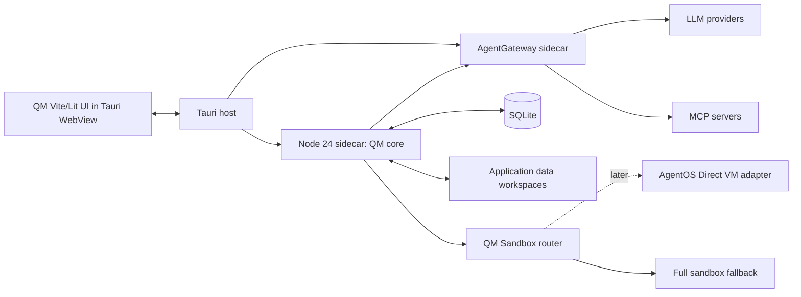

# NorthBridge AgentNET Local-First Desktop Architecture

**Status:** Adopted for the desktop deployment track.
**Scope:** Personal or single-device QM command center.

## Decision

NorthBridge will preserve QM as the orchestration core and package it as a local-first Tauri v2 desktop deployment target. Tauri is a native shell and process supervisor, not a replacement backend. The runtime comprises the existing QM Vite/Lit user interface, a bundled Node 24 runtime running QM, a bundled AgentGateway binary, durable SQLite desktop adapters, and local workspaces. AgentOS is deferred to an optional future `Sandbox` adapter.

| Approach | Trade-offs | Cost | Setup complexity |
| --- | --- | --- | --- |
| **Chosen: QM + Tauri + SQLite + AgentGateway** | Retains QM behavior and needs focused desktop wiring and SQLite adapters. | No mandatory server cost. | Moderate. |
| QM with Docker sandbox | Fastest developer route but requires Docker Desktop. | Local resources plus provider cost. | Low for developers, high for end users. |
| Full AgentOS actor replacement | Duplicates QM sessions, policies, scheduling, and persistence. | Runtime dependent. | High risk. |
| Rust rewrite | Discards working Node harnesses and contracts. | Engineering cost dominates. | Extreme. |

## Runtime topology

## Sidecar protocol

The host resolves application data, retrieves provider credentials from OS-native secure storage, generates a fresh boot token, atomically writes a versioned gateway configuration, starts AgentGateway, validates readiness, starts Node 24 with QM, and only then reveals the WebView. QM receives loopback provider base URLs and the boot-scoped token. On exit, the host gracefully shuts down QM and AgentGateway before recording a redacted lifecycle result.

All internal endpoints bind to `127.0.0.1`. The WebView cannot run arbitrary commands, choose a sidecar path, or call the raw AgentGateway administration endpoint. Tauri exposes a typed, narrow IPC interface. AgentGateway routes provider-qualified LLM models and MCP targets while keeping provider values out of QM and local persistence. [1] [2] [3]

## Desktop durability

The zero-infrastructure target requires SQLite adapters behind QM persistence interfaces. PostgreSQL stores migrate to SQLite transactions, `pg-boss` migrates to a durable SQLite queue, remote blobs migrate to application-data storage, and multi-node locking becomes a single-instance lock plus local lease. Store opaque secret references only; secret values remain in the operating-system vault. This migration is the largest engineering stream and is not claimed complete by the initial executable milestone.

## Sandbox boundary

The initial desktop build retains a restricted local or optional Docker/full-sandbox backend. A later `AgentOsSandbox` may implement the existing QM `Sandbox` contract using the Direct VM API. QM remains owner of session lifecycle, policy, scheduling, approvals, and durable state. AgentOS Direct VM persistence is in memory by default without configured mounts and cannot replace full sandbox capabilities such as Docker, kernel modules, eBPF, or file watching. Benchmark representative QM workloads before default adoption. [4] [5] [6]

## Delivery sequence

1. Add a desktop wiring profile without changing QM HTTP contracts.
2. Wrap the existing QM Vite/Lit UI in Tauri rather than maintaining another frontend.
3. Bundle Node 24, QM resources, and the checksum-verified AgentGateway binary.
4. Route provider traffic through loopback AgentGateway endpoints.
5. Implement SQLite stores and durable local queue adapters one interface family at a time.
6. Add OS-native secrets, lifecycle diagnostics, and restricted local execution.
7. Prototype AgentOS only as a sandbox adapter and retain a full-sandbox fallback.

## First executable milestone

The app starts one AgentGateway and one Node 24 QM process, validates both before exposing the UI, routes QM provider traffic through AgentGateway, maintains loopback-only internal services, and stops both children gracefully. It does not embed provider secrets in `qm.sqlite` and does not claim SQLite parity before adapter, migration, and recovery tests pass.

## References

[1] [Tauri Node.js sidecar guidance](https://v2.tauri.app/learn/sidecar-nodejs/)
[2] [AgentGateway LLM routing](https://agentgateway.dev/docs/standalone/latest/llm/about/)
[3] [AgentGateway diagnostics](https://agentgateway.dev/docs/standalone/latest/operations/debug/)
[4] [AgentOS Direct VM API](https://agentos-sdk.dev/docs/core)
[5] [AgentOS limitations](https://agentos-sdk.dev/docs/limitations/)
[6] [AgentOS benchmark methodology](https://agentos-sdk.dev/docs/performance)
